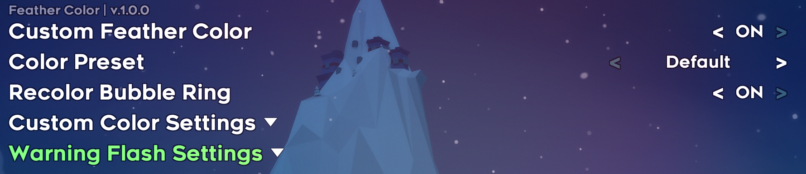

# CelesteFeatherColor
Changes the color of the feather in Celeste

An [Everest](https://everestapi.github.io/) mod for [Celeste](http://www.celestegame.com/) that lets you recolor the flying feather.

Installation Guide
------------------
1. Install [Everest/Olympus](https://everestapi.github.io/) for [Celeste](http://www.celestegame.com/).
2. Download the mod from [GameBanana](https://gamebanana.com/mods/727926) and put the zip in your Mods folder.
3. Launch the game and open Mod Options → Feather Color.

Features
--------

**Color Presets**

Default, Custom, RGB, Custom Cycle, Red, Orange, Green, Cyan, Blue, Purple, Pink, White, Black, Rainbow, Trans, Bisexual, Lesbian

**Recolor Bubble Ring**

Simply recolors the bubble ring that holds the feather into the current color of the feather

**Custom Color Settings**

Custom:	Any color from a 6-digit hex value
RGB:	Red / Green / Blue sliders (0-255)
Custom Cycle:	Fades through up to 4 hex colors of your choice and loops
The animated presets (Rainbow, the flags, Custom Cycle) share a Color Change Speed setting (1-10).

**Warning flash Settings**

When a feather is about to run out, vanilla flashes Madeline red. You can turn the flash off (she keeps one solid color until the feather runs out), or change the flash color (preset or custom hex).
